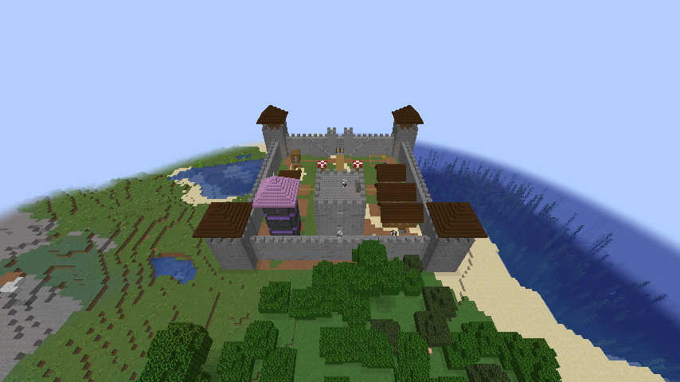
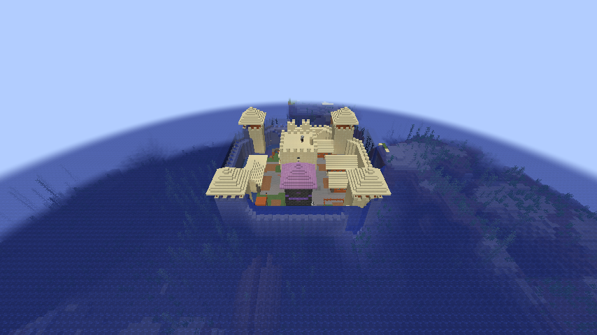
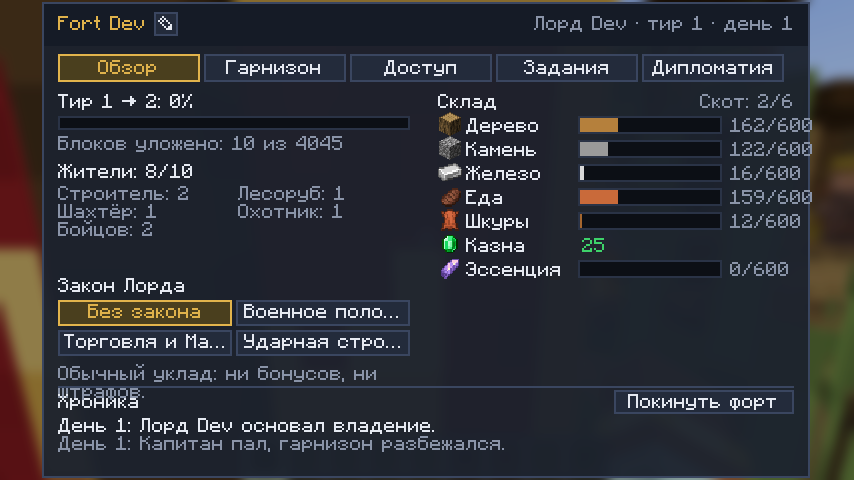
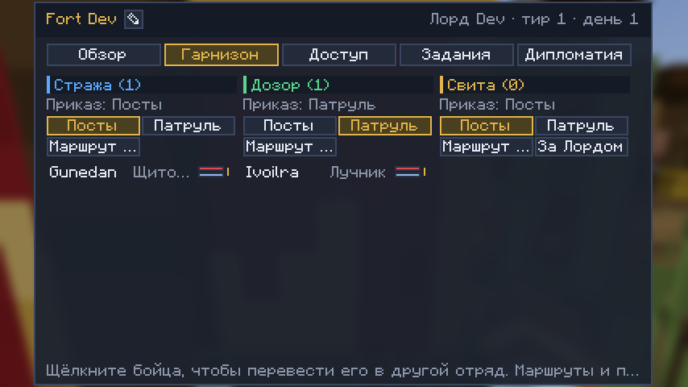
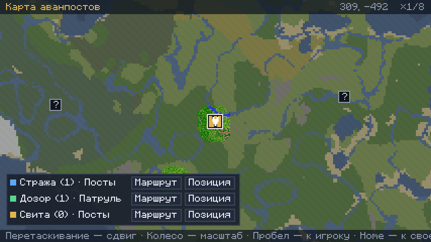

# Lord's Outpost

Мод для **Minecraft 1.21.1 / NeoForge**. В мире появляются аванпосты мародёров пяти уровней сложности. Игрок штурмует форт, убивает Капитана и ставит Штандарт Лорда. После этого форт становится его владением: жители сами строят его до третьего тира, добывают ресурсы, отбивают набеги и водят караваны, даже когда игрока рядом нет.



| Пограничная Застава, тир 1 | Цитадель в пустынной палитре, тир 3 |
|---|---|
|  |  |

## Сборка

Нужны **JDK 21** и интернет.

```bash
./gradlew build          # Windows: gradlew.bat build
```

Готовый мод появится в `build/libs/lordsoutpost-0.1.0.jar`. Положите его в папку `mods` клиента или сервера с NeoForge 21.1.x. Мод нужен и на сервере, и у каждого игрока.

Для разработки:

```bash
./gradlew runClient                              # клиент с модом
./gradlew runClient -PquickPlay=localhost:25565  # клиент сразу заходит на локальный сервер
./gradlew runServer                              # выделенный сервер
./gradlew runGameTestServer                      # игровые тесты (их же запускает GitHub)
```

Необязательные моды, с которыми Lord's Outpost работает сам:
- **Iron's Spells 'n Spellbooks**: Придворный Маг и сундуки Капитанов дают свитки, руны и чернила. Без мода Маг делает ванильные зачарованные книги, лазурит и пузырьки опыта.
- **Solo Status System**: титул «Лорд» в окне Системы и достижения за штурм фортов (см. ниже).

## Как играть

| Действие | Клавиша |
|---|---|
| Карта аванпостов | **M** |
| Управление своим аванпостом | **O**, либо ПКМ по Управляющему, Штандарту или Доске заданий |

1. **Найдите аванпост.** В 1200–1500 блоках форт появляется на карте знаком **?**. Когда вы подходите на 110 блоков, сверху выезжает баннер «Найден Аванпост» с черепками сложности, а знак вопроса сменяется значком форта.
2. **Возьмите его штурмом.** Решётка ворот не пускает чужих, лучники стоят на стенах и башнях. Капитан сидит в донжоне и ведёт себя как босс: полоса здоровья появляется в бою, а с ростом сложности у него открываются рывок, боевой клич с подкреплением, клыки из земли и ярость.
3. **Станьте Лордом.** С Капитана падает **Штандарт Лорда**. Поставьте его во дворе: гарнизон уходит, приходят первые поселенцы, игра предлагает назвать форт, а вы получаете титул **[Лорд]** перед именем в чате и списке игроков. Один игрок владеет только одним аванпостом.
4. **Правьте.** Поселение живёт само. Вы задаёте законы, отряды, права и договоры и помогаете с нехватками через Доску заданий. В Сундуке Дани копится ваш доход: изумруды, а на тир 3 ещё плоды работы Мага.

Чтобы отказаться от владения, сломайте Штандарт крадучись или нажмите «Покинуть форт» во вкладке «Обзор». Если захваченный форт пустует 5 игровых дней, в него возвращаются мародёры.

### Пять сложностей

| Черепки | Аванпост | Отстроен при генерации | Гарнизон |
|---|---|---|---|
| 💀 | Пограничная Застава | тир 1 | Капитан + 4 |
| 💀💀 | Дозорный Форт | тир 1 и половина тира 2 | Капитан + 6 |
| 💀💀💀 | Укреплённый Редут | тир 2 | Капитан + 9 |
| 💀💀💀💀 | Цитадель Мародёров | тир 2 и 60% тира 3, свитки Iron's Spells у Капитана | Капитан + 12 |
| 💀💀💀💀💀 | Великая Крепость | почти готовый тир 3 с башней Мага | Капитан + 16 |

Чем дальше от центра мира, тем чаще встречаются сильные форты. Экипировка мародёров (кожа, кольчуга, железо, алмаз) и сила Капитана тоже растут с числом черепков.

### Разные аванпосты

Форт собирается из двух **планировок** и четырёх **палитр**, а поворот ворот выбирается случайно:

- **Квадратная**: донжон у дальней стены, службы вдоль боковых стен.
- **Восьмиугольная**: донжон в центре, службы стоят кольцом.
- **Палитры по биому**: деревянная (равнины, леса), северная (тайга, снега), пустынная (пустыни, саванны, бесплодные земли), тёмная (джунгли, тёмный лес, болота).

Тир 1 — частокол, сторожевая вышка, зал вождя, навесы. Тир 2 — каменные стены с боевым ходом, угловые башни, донжон в два этажа, склад, кузница, казарма, лазарет. Тир 3 — двойная стена, башни под крышами, донжон в три этажа, вторая казарма, торговые ряды и **башня Придворного Мага**.

Каждый тир — это чертёж. Генерация мира, строители и офлайн-симуляция работают по одному и тому же чертежу. Поэтому форт, достроенный без игрока, блок в блок совпадает с тем, что строители поставили бы у него на глазах.

## Окно управления

| | |
|---|---|
|  |  |
|  |  |

- **Обзор**: стройка (тир, процент, нехватка), жители по профессиям, склад, загон, закон, хроника событий.
- **Гарнизон**: три отряда (Стража, Дозор, Свита) и их приказы: Посты, Патруль по маршруту, Держать позицию, За Лордом. Щелчок по бойцу переводит его в другой отряд. В подсказке видны здоровье, броня, снаряжение и победы.
- **Доступ** (Гарнизонный Устав): список игроков с уровнями 🟢 Союзник, 🟡 Гость, 🔴 Враг, уровень для незнакомцев и три переключателя: союз с Лордами союзных фортов, доступ союзников к Сундуку Дани, защита территории от чужаков.
- **Задания**: реальные нехватки поселения и кнопка «Сдать» прямо из инвентаря.
- **Дипломатия**: разведанные соседи, торговые и военные пакты, караваны.

### Права

| | Ворота | Цитадель | Сундуки и станки | Сундук Дани | Ломать и ставить | Стража |
|---|---|---|---|---|---|---|
| Лорд | ✔ | ✔ | ✔ | ✔ | ✔ | своя |
| 🟢 Союзник | ✔ | ✔ | ✔ | если разрешено | ✘ | дружелюбна |
| 🟡 Гость | ✔ | ✘ | ✘ | ✘ | ✘ * | нейтральна |
| 🔴 Враг | ✘ | ✘ | ✘ | ✘ | ✘ * | атакует в периметре |

\* Если выключить «Защиту территории», гости и враги смогут ломать блоки. Союзники не ломают никогда. Под защитой взрывы тоже не разрушают постройки.

Решётка ворот не открывается и не закрывается: свои проходят сквозь неё, а для чужих это стена. Поэтому ворота нельзя «забыть закрыть».

## Карта (M)

| | |
|---|---|
|  |  |

Карта мода рисует увиденную местность по цветам блоков, с тенями рельефа и глубиной воды. Плитки сохраняются на диск в `lordsoutpost/map/`. Ещё не разведанные земли показаны приглушённой картой биомов. Сервер считает её по шуму генератора в фоновом потоке, не загружая и не создавая чанки.

Слои: зелёный контур периметра, жёлтый пунктир расширения до следующего тира, маршруты и значки отрядов, анимированные караваны, знаки **?** и иконки фортов (цвет показывает отношение), игроки.

Что можно делать:
- щёлкнуть по форту: сведения, расстояние, пакты и караван;
- нажать «Маршрут» у отряда, расставить до 12 точек кругового патруля и нажать «Готово»;
- нажать «Позиция» и щёлкнуть место, которое отряд должен держать.

Управление: перетаскивание — сдвиг, колесо — масштаб от 1/8 до ×8, Пробел — к себе, Home — к своему форту.

## Жители и бойцы

| Житель | Работа |
|---|---|
| Управляющий | ведёт Доску заданий и отправляет караваны. Без него дань вдвое меньше и заданий нет |
| Строитель | ставит блоки чертежа по одному, с анимацией и звуком |
| Лесоруб, Шахтёр | дерево; камень и железо |
| Охотник | выслеживает дичь за стенами (на склад идут мясо и шкуры), скот в загоне не трогает |
| Скотовод | пригоняет животных в загон и держит стадо: еда и шерсть |
| Кузнец | чинит броню стражи за шкуры и железо, потом перековывает снаряжение до уровня тира |
| Караванщик | водит караваны (со 2-го тира) |
| Придворный Маг | на 3-м тире превращает эссенцию в свитки и руны Iron's Spells или ванильную магию |

Бойцы — гибрид разбойника и жителя: тело разбойника, голова жителя. Роль задаёт оружие со склада: **Щитовик** (меч и щит, принимает на щит половину урона спереди), **Берсерк** (топор), **Лучник**, **Арбалетчик**. Павшего бойца выносят в лазарет, если есть свободная койка. Свиту из похода выносят всегда.


## Экономика, законы, задания

- **Склад**: дерево, камень, железо, еда, шкуры, казна, эссенция. Ёмкость растёт с тиром. Предметы можно класть в бочку снабжения на складе, и они сразу становятся ресурсами.
- **Еда**: 6 в день на жителя. Голод вдвое замедляет всю работу. Население растёт, пока есть запас еды, до 10, 18 или 28 жителей в зависимости от тира.
- **Законы Лорда** (один активный, смена раз в игровой день):
  - *Военное положение*: оборона +30%, стража бьёт сильнее, новобранцев в 1,5 раза больше; добыча −25%.
  - *Торговля и Магия*: дань и прибыль караванов +50%, Маг вдвое быстрее; оборона −10%.
  - *Ударная стройка*: стройка вдвое быстрее; еды на четверть больше, добыча −15%.
- **Доска заданий**: задание появляется только при настоящей нехватке. Это могут быть материалы для ближайших 300 блоков стройки, починка брони, еда или ингредиенты для Мага. Если помочь, вы получите изумруды, а связанная работа 20 минут идёт вдвое быстрее. Без игрока жители справятся сами, просто медленнее, и задание исчезнет.

## Дипломатия, караваны, дороги, набеги

- **Пакты.** С мародёрами пакт покупается у Капитана за золото казны: торговый стоит 20 × черепки, военный 50 × черепки. С другим Лордом пакт заключается по взаимному согласию. Торговый пакт открывает караваны и прибавляет дань. Военный требует торгового, отменяет набеги этого соседа и приводит его помощь в обороне.
- **Караван**: Караванщик с ламой и 2–3 конвоира везут излишки к партнёру, торгуют и возвращаются с выручкой. Половина выручки идёт в казну, половина в дань. Рядом с игроком караван — настоящий отряд на дороге. Вдали это точка на карте с тем же темпом и шансом засады. Военный пакт и конвой снижают риск засады.
- **Дороги**: тропинка, гравий, булыжник, каменный кирпич и всё из тега `lordsoutpost:roads` ускоряют движение в **1,35 раза** и караваны, и игроков, и жителей. Чем большая часть пути проложена по дорогам, тем быстрее идут виртуальные караваны.
- **Набеги**: в среднем раз в 4 игровых дня. Приходят от ближайшего дикого форта, а если все соседи замирены, то бродячие банды, но реже. При игроке это бой у ворот, мирные жители прячутся в донжоне. Вдали исход считается по силе гарнизона, стен и союзников. Проигрыш стоит части склада.

## A-Life: жизнь без игрока

```
             ┌────────────── OutpostSavedData (data/lordsoutpost.dat) ──────────────┐
             │ форты, жители, склад, отряды, права, пакты, караваны, хроника        │
             └───────────────┬───────────────────────────────────┬──────────────────┘
       макро-тик раз в 5 с   │                                   │  чанки форта загружены
                             ▼                                   ▼
                  Simulation (экономика)              ChunkReconciliation
                  добыча, еда, рост, стройка          блоки по чертежу, сущности по записям,
                  кузня, Маг, дань, набеги, караваны  стройка руками строителей, караваны на дороге
```

Источник правды — запись аванпоста, а не сущности в мире. Жители не сохраняются в чанки. Пока игрок рядом, по записям создаются сущности. Когда чанк выгружается, их состояние (здоровье, раны) возвращается в запись. Поэтому у жителя не бывает двух тел и никто не теряется. Чанки никогда не грузятся принудительно: далёкий форт — это несколько килобайт данных и почти ничего не стоит серверу. Когда игрок возвращается, всё построенное без него встаёт блоками, а поселенцы и караваны появляются на своих местах.

Подробнее: [docs/ARCHITECTURE.md](docs/ARCHITECTURE.md).

## Связь с Solo Status System

Если установлен Solo Status System, Lord's Outpost через его открытый `SoloStatusApi` (без жёсткой зависимости):
- выдаёт и **надевает титул «Лорд»** (+2 к Силе и Выносливости), когда игрок ставит Штандарт. Носить титул можно только пока вы владеете аванпостом; при отказе он снимается;
- ведёт счётчики для достижений: «Гроза мародёров» (25 мародёров), «Покоритель» (первый захват), «Полководец» (5 захватов), «Хозяин Цитадели» (тир 3), «Радетель» (10 заданий), скрытое «Сокрушитель крепостей» (Великая Крепость);
- начисляет опыт Системы за захват (400 × черепки²) и за задания.

## Команды администратора (права 2)

```
/outpost nearest                 ближайший форт (с кнопкой телепорта)
/outpost list | info | reveal    список, сведения о форте под ногами, разведать всё в 3000 блоках
/outpost create <1-5> [square|octagon] [timber|northern|desert|darkwood]
/outpost capture                 убить Капитана: форт захвачен, Штандарт в инвентарь
/outpost found [имя]             сразу стать Лордом форта под ногами
/outpost tier <1-3> | sim <дни> | stock <ресурс> <число> | raid | remove
```

Настройки сервера лежат в `serverconfig/lordsoutpost-server.toml` в папке мира: радиусы обнаружения, скорость стройки и добычи, дань, сила помощи игрока, набеги, возврат мародёров, здоровье Капитана, скорость на дорогах, префикс титула. Там же есть `retrofitOldChunks`, чтобы достраивать форты в старых чанках.

## Что проверено

- **11 игровых тестов** на настоящем выделенном сервере (`runGameTestServer`, тот же прогон на GitHub):
  - все 8 сочетаний планировки и палитры, все тиры и рабочие точки;
  - планы стройки при четырёх поворотах;
  - офлайн-поселение с первого черепка без игрока доходит до тира 3 примерно за 22 игровых дня;
  - задания, набеги, пакты и караваны;
  - права всех уровней, сохранение и загрузка;
  - полный цикл форта в загруженных чанках: постройка, гарнизон, смерть Капитана, выпадение Штандарта, основание, приход жителей, строители кладут блоки;
  - титул в Solo Status System (тест прогнан локально вместе с его jar);
  - таблицы добычи Iron's Spells.
- Клиент запускался в этой среде, заходил на сервер, снимки выше сделаны в нём: генерация форта, Капитан, окно управления, карта, маршрут патруля.
- Предсказание мест фортов совпадает с генерацией: `/locate structure` указывает в 11 блоков от предсказанного центра.

**Не проверено вживую:**
- **Iron's Spells.** Скачать мод в этой среде не удалось, поэтому таблицы добычи с ним проверит второй прогон тестов на GitHub. Если он упадёт, Маг откатится к ванильной добыче, но об этом надо сообщить.
- **Игра двух игроков.** Права, ворота и пакты между Лордами покрыты тестами, но двумя клиентами не проверялись.
- **Физический караван, набег у ворот и засады** в загруженных чанках.
- **Производительность**, когда открыты сотни фортов.

## Документация

- [docs/ARCHITECTURE.md](docs/ARCHITECTURE.md): устройство кода, A-Life, согласование, сеть, сохранение.
