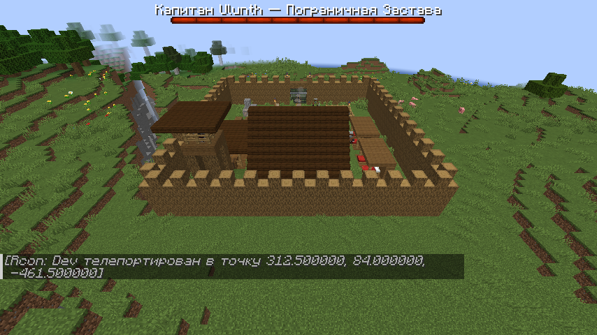
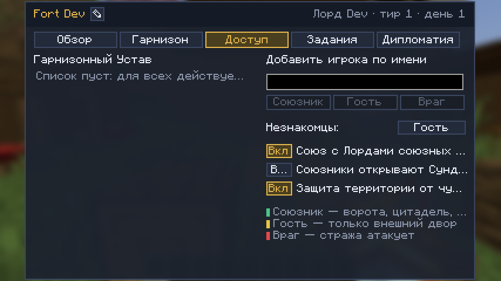
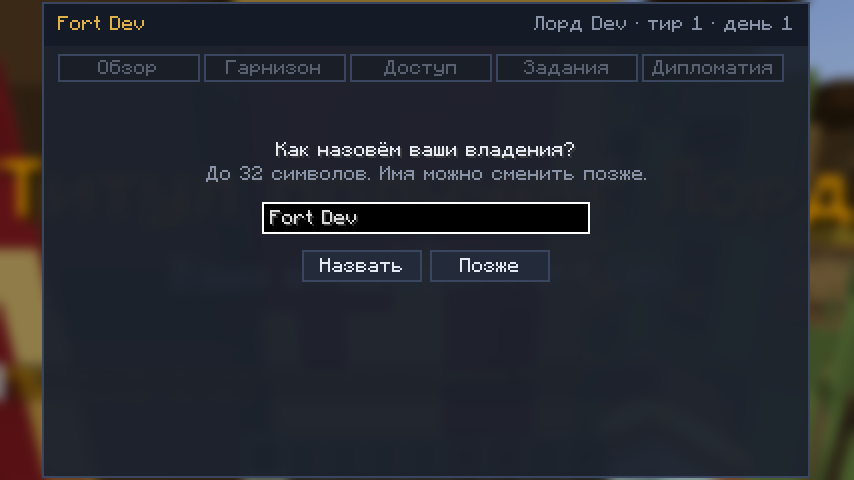
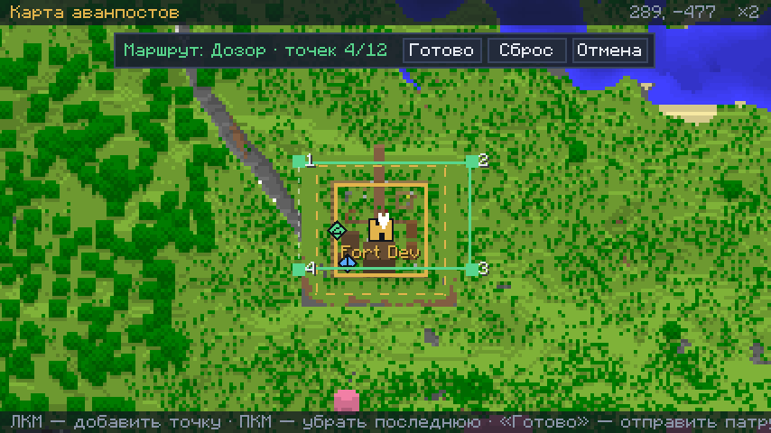
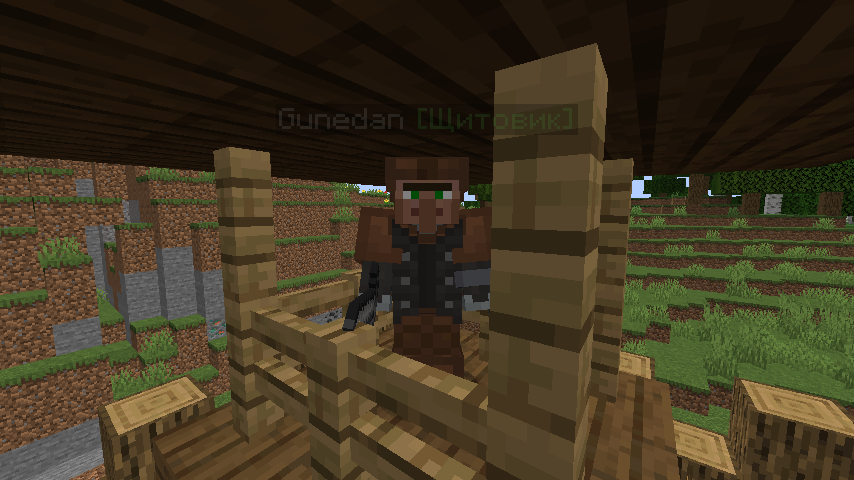

# Lord's Outpost

Мод для **Minecraft 1.21.1 / NeoForge**. В мире появляются аванпосты мародёров пяти уровней сложности. Игрок штурмует форт, убивает Лорд мародёрова и ставит Штандарт Лорда. После этого форт становится его владением: жители сами строят его до третьего тира, добывают ресурсы, отбивают набеги и водят караваны, даже когда игрока рядом нет.


| Пограничная Застава, тир 1 | Цитадель в пустынной палитре, тир 3 |
|---|---|
|  |  |

## Сборка

Нужны **JDK 21** и интернет.

```bash
./gradlew build          # Windows: gradlew.bat build
```

Готовый мод появится в `build/libs/lordsoutpost-0.1.0.jar`. Положите его в папку `mods` клиента или сервера с NeoForge 21.1.x. Мод нужен и на сервере, и у каждого игрока.

Для разработки:

```bash
./gradlew runClient                              # клиент с модом
./gradlew runClient -PquickPlay=localhost:25565  # клиент сразу заходит на локальный сервер
./gradlew runServer                              # выделенный сервер
./gradlew runGameTestServer                      # игровые тесты в своей папке run/gametest (их же запускает GitHub)
```

Необязательные моды, с которыми Lord's Outpost работает сам:
- **Epic Fight**: бойцы с оружием и Лорд мародёров переходят на скелет и анимации Epic Fight (см. ниже).
- **Iron's Spells 'n Spellbooks**: Придворный Маг и сундуки Лордов мародёров дают свитки, руны и чернила. Без мода Маг делает ванильные зачарованные книги, лазурит и пузырьки опыта.
- **Solo Status System**: титул «Лорд» в окне Системы и достижения за штурм фортов (см. ниже).

## Как играть

| Действие | Клавиша |
|---|---|
| Карта аванпостов | **M** |
| Управление своим аванпостом | **O**, либо ПКМ по Управляющему, Штандарту или Доске заданий |

1. **Найдите аванпост.** В 1200–1500 блоках форт появляется на карте знаком **?**. Когда вы подходите на 110 блоков, сверху выезжает баннер «Найден Аванпост» с черепками сложности, а знак вопроса сменяется значком форта.
2. **Возьмите его штурмом.** Решётка ворот не пускает чужих, лучники стоят на стенах и башнях. В донжоне сидит босс — **Лорд мародёров**. Он обычного роста и не перекачан здоровьем (48 на одном черепке, 120 на пяти), но воюет с умом. Пока у него не меньше двух стражников, он держится в 6–9 блоках за их спинами, прикрывается щитом и бросает стражу на врага. Сам рубится, только если вы прорвались вплотную или стража пала. На четверти здоровья отходит к трону, пьёт зелье и зовёт подмогу. С ростом сложности у него открываются рывок, боевой клич, клыки из земли и ярость. Полоса его здоровья видна только у стен форта (до 12 блоков от периметра) или рядом с ним самим, а не за сотни блоков.
3. **Станьте Лордом.** С Лорда мародёров падает **Штандарт Лорда**. Поставьте его во дворе: гарнизон уходит, приходят первые поселенцы, игра предлагает назвать форт, а вы получаете титул **[Лорд]** перед именем в чате и списке игроков. Один игрок владеет только одним аванпостом.
4. **Правьте.** Поселение живёт само. Вы задаёте законы, отряды, права и договоры и помогаете с нехватками через Доску заданий. В Сундуке Дани копится ваш доход: изумруды, а на тир 3 ещё плоды работы Мага.

Чтобы отказаться от владения, сломайте Штандарт крадучись или нажмите «Покинуть форт» во вкладке «Обзор». Если захваченный форт пустует 5 игровых дней, в него возвращаются мародёры.

### Пять сложностей

| Черепки | Аванпост | Отстроен при генерации | Гарнизон |
|---|---|---|---|
| 💀 | Пограничная Застава | тир 1 | Лорд мародёров + 4 |
| 💀💀 | Дозорный Форт | тир 1 и половина тира 2 | Лорд мародёров + 6 |
| 💀💀💀 | Укреплённый Редут | тир 2 | Лорд мародёров + 9 |
| 💀💀💀💀 | Цитадель Мародёров | тир 2 и 60% тира 3, свитки Iron's Spells у Лорда мародёров | Лорд мародёров + 12 |
| 💀💀💀💀💀 | Великая Крепость | почти готовый тир 3 с башней Мага | Лорд мародёров + 16 |

Чем дальше от центра мира, тем чаще встречаются сильные форты. Экипировка мародёров (кожа, кольчуга, железо, алмаз) и сила Лорда мародёров тоже растут с числом черепков.

### Разные аванпосты

Форт собирается из двух **планировок** и четырёх **палитр**, а поворот ворот выбирается случайно:

- **Квадратная**: донжон у дальней стены, службы вдоль боковых стен.
- **Восьмиугольная**: донжон в центре, службы стоят кольцом.
- **Палитры по биому**: деревянная (равнины, леса), северная (тайга, снега), пустынная (пустыни, саванны, бесплодные земли), тёмная (джунгли, тёмный лес, болота).

Тир 1 — частокол, сторожевая вышка, зал вождя, навесы. Тир 2 — каменные стены с боевым ходом, угловые башни, донжон в два этажа, склад, кузница, казарма, лазарет. Тир 3 — двойная стена, башни под крышами, донжон в три этажа, вторая казарма, торговые ряды и **башня Придворного Мага**.

Каждый тир — это чертёж. Генерация мира, строители и офлайн-симуляция работают по одному и тому же чертежу. Поэтому форт, достроенный без игрока, блок в блок совпадает с тем, что строители поставили бы у него на глазах.

## Окно управления

| | |
|---|---|
|  |  |
|  |  |

- **Обзор**: стройка (тир, процент, нехватка), жители по профессиям, склад, загон, закон, хроника событий.
- **Гарнизон**: три отряда (Стража, Дозор, Свита) и их приказы: Посты, Патруль по маршруту, Держать позицию, За Лордом. Щелчок по бойцу переводит его в другой отряд. В подсказке видны здоровье, броня, снаряжение и победы.
- **Доступ** (Гарнизонный Устав): список игроков с уровнями 🟢 Союзник, 🟡 Гость, 🔴 Враг, уровень для незнакомцев и три переключателя: союз с Лордами союзных фортов, доступ союзников к Сундуку Дани, защита территории от чужаков.
- **Задания**: реальные нехватки поселения и кнопка «Сдать» прямо из инвентаря.
- **Дипломатия**: разведанные соседи, торговые и военные пакты, караваны.

### Права

| | Ворота | Цитадель | Сундуки и станки | Сундук Дани | Ломать и ставить | Стража |
|---|---|---|---|---|---|---|
| Лорд | ✔ | ✔ | ✔ | ✔ | ✔ | своя |
| 🟢 Союзник | ✔ | ✔ | ✔ | если разрешено | ✘ | дружелюбна |
| 🟡 Гость | ✔ | ✘ | ✘ | ✘ | ✘ * | нейтральна |
| 🔴 Враг | ✘ | ✘ | ✘ | ✘ | ✘ * | атакует в периметре |

\* Если выключить «Защиту территории», гости и враги смогут ломать блоки. Союзники не ломают никогда. Под защитой взрывы тоже не разрушают постройки.

Решётка ворот не открывается и не закрывается: свои проходят сквозь неё, а для чужих это стена. Поэтому ворота нельзя «забыть закрыть».

## Карта (M)

| | |
|---|---|
|  |  |

Карта мода рисует увиденную местность по цветам блоков, с тенями рельефа и глубиной воды. Плитки сохраняются на диск в `lordsoutpost/map/`. Ещё не разведанные земли показаны приглушённой картой биомов. Сервер считает её по шуму генератора в фоновом потоке, не загружая и не создавая чанки.

Слои: зелёный контур периметра, жёлтый пунктир расширения до следующего тира, маршруты и значки отрядов, анимированные караваны, знаки **?** и иконки фортов (цвет показывает отношение), игроки.

Что можно делать:
- щёлкнуть по форту: сведения, расстояние, пакты и караван;
- нажать «Маршрут» у отряда, расставить до 12 точек кругового патруля и нажать «Готово»;
- нажать «Позиция» и щёлкнуть место, которое отряд должен держать.

Управление: перетаскивание — сдвиг, колесо — масштаб от 1/8 до ×8, Пробел — к себе, Home — к своему форту.

## Жители и бойцы

| Житель | Работа |
|---|---|
| Управляющий | ведёт Доску заданий и отправляет караваны. Без него дань вдвое меньше и заданий нет |
| Строитель | ставит блоки чертежа по одному, с анимацией и звуком |
| Лесоруб | находит дикое дерево рядом с дровяным двором, рубит его по брёвнышку сверху вниз, сажает саженец и несёт брёвна на склад |
| Шахтёр | спускается по лестнице шахты и прокладывает настоящий туннель: главный ход на 32 блока и боковые штреки через каждые 4. Ставит факелы, заделывает воду и лаву булыжником, руду и камень несёт на склад. Получает опыт за каждый реально добытый блок: уровни 1–5 открываются на 0/50/150/300/500 блоках; тир кирки ограничен одновременно уровнем шахтёра и тиром аванпоста (камень → железо → алмаз) |
| Охотник | обходит стены снаружи и стреляет дичь настоящими стрелами только за стенами; мясо и шкуры несёт на склад, скот в загоне не трогает |
| Скотовод | приводит на поводке животных из округи через калитку загона, разводит их (тратит еду), стрижёт овец, а лишних забивает |
| Кузнец | чинит броню стражи за шкуры и железо, потом перековывает снаряжение до уровня тира |
| Караванщик | водит караваны (со 2-го тира) |
| Придворный Маг | на 3-м тире превращает эссенцию в свитки и руны Iron's Spells или ванильную магию |

### Жители работают руками

Пока игрок рядом, лесоруб, шахтёр, охотник и скотовод не «начисляют» ресурсы, а добывают их в мире: ломают блоки, бьют дичь, водят скот. Всё добытое лежит у них в сумке (12 ячеек) и относится на **склад**, когда сумка полна, к вечеру или при выгрузке чанка. Без дела житель не стоит:
- работы нет (нет деревьев, туннель кончился, загон полон) — подбирает **предметы, лежащие на земле** в пределах форта, и несёт их на склад; потом занимается хозяйством на своём рабочем месте и через полминуты снова ищет работу;
- ночью сначала разгружается, потом идёт спать.

Пока житель недавно (2 минуты) работал руками, симуляция не считает его виртуальную добычу, поэтому ничего не удваивается. Когда игрока нет, работа снова идёт виртуально по тем же ставкам. Команды `/outpost workers` и `/outpost mine` показывают, кто чем занят и где идёт туннель.

### Склад

У каждого форта во дворе стоит склад: на тире 1 деревянная кладовая, с тира 2 каменный склад в два яруса бочек. Его **бочки показывают настоящий запас** дерева, камня, железа, еды и шкур: сколько ресурса в записи форта, столько предметов в бочках (сколько поместится). Жители кладут добычу прямо туда. При заполнении ноши на 75% (9 из 12 занятых слотов), вечером или при выгрузке чанка они возвращаются на склад. Игрок с правом союзника может взять или положить предметы руками, и запас изменится. Положенное по заданию засчитывается как помощь.

Склад запирается **дверью склада**: её открывают только жители своего форта и игроки с уровнем доступа не ниже союзника. Чужие жители, мародёры, налётчики и гости пройти не могут. У двери стоят два поста: ближние бойцы встают туда в первую очередь.

Бойцы — гибрид разбойника и жителя: тело разбойника, голова жителя. Роль задаёт оружие со склада: **Щитовик** (меч и щит, принимает на щит половину урона спереди), **Берсерк** (топор), **Лучник**, **Арбалетчик**. Павшего бойца выносят в лазарет, если есть свободная койка. Свиту из похода выносят всегда.



## Экономика, законы, задания

- **Склад**: дерево, камень, железо, еда, шкуры, казна, эссенция. Ёмкость растёт с тиром. Первые пять ресурсов лежат в бочках склада настоящими предметами (см. «Склад» выше).
- **Еда**: 6 в день на жителя. Голод вдвое замедляет всю работу. Население растёт, пока есть запас еды, до 10, 18 или 28 жителей в зависимости от тира.
- **Законы Лорда** (один активный, смена раз в игровой день):
  - *Военное положение*: оборона +30%, стража бьёт сильнее, новобранцев в 1,5 раза больше; добыча −25%.
  - *Торговля и Магия*: дань и прибыль караванов +50%, Маг вдвое быстрее; оборона −10%.
  - *Ударная стройка*: стройка вдвое быстрее; еды на четверть больше, добыча −15%.
- **Доска заданий**: задание появляется только при настоящей нехватке. Это могут быть материалы для ближайших 300 блоков стройки, починка брони, еда или ингредиенты для Мага. Если помочь, вы получите изумруды, а связанная работа 20 минут идёт вдвое быстрее. Без игрока жители справятся сами, просто медленнее, и задание исчезнет.

## Дипломатия, караваны, дороги, набеги

- **Пакты.** С мародёрами пакт покупается у Лорда мародёров за золото казны: торговый стоит 20 × черепки, военный 50 × черепки. С другим Лордом пакт заключается по взаимному согласию. Торговый пакт открывает караваны и прибавляет дань. Военный требует торгового, отменяет набеги этого соседа и приводит его помощь в обороне.
- **Караван**: Караванщик с ламой и 2–3 конвоира везут излишки к партнёру, торгуют и возвращаются с выручкой. Половина выручки идёт в казну, половина в дань. Рядом с игроком караван — настоящий отряд на дороге. Вдали это точка на карте с тем же темпом и шансом засады. Военный пакт и конвой снижают риск засады.
- **Дороги**: тропинка, гравий, булыжник, каменный кирпич и всё из тега `lordsoutpost:roads` ускоряют движение в **1,35 раза** и караваны, и игроков, и жителей. Чем большая часть пути проложена по дорогам, тем быстрее идут виртуальные караваны.
- **Набеги**: в среднем раз в 4 игровых дня. Приходят от ближайшего дикого форта, а если все соседи замирены, то бродячие банды, но реже. При игроке это бой у ворот, мирные жители прячутся в донжоне. Вдали исход считается по силе гарнизона, стен и союзников. Проигрыш стоит части склада.

## A-Life: жизнь без игрока

```
             ┌────────────── OutpostSavedData (data/lordsoutpost.dat) ──────────────┐
             │ форты, жители, склад, отряды, права, пакты, караваны, хроника        │
             └───────────────┬───────────────────────────────────┬──────────────────┘
       макро-тик раз в 5 с   │                                   │  чанки форта загружены
                             ▼                                   ▼
                  Simulation (экономика)              ChunkReconciliation
                  добыча, еда, рост, стройка          блоки по чертежу, сущности по записям,
                  кузня, Маг, дань, набеги, караваны  стройка руками строителей, караваны на дороге
```

Источник правды — запись аванпоста, а не сущности в мире. Жители не сохраняются в чанки. Пока игрок рядом, по записям создаются сущности. Когда чанк выгружается, их состояние (здоровье, раны) возвращается в запись. Поэтому у жителя не бывает двух тел и никто не теряется. Чанки никогда не грузятся принудительно: далёкий форт — это несколько килобайт данных и почти ничего не стоит серверу. Когда игрок возвращается, всё построенное без него встаёт блоками, а поселенцы и караваны появляются на своих местах.

**Пока мир закрыт**, игровое время стоит, но форты живут дальше. Мод запоминает, когда мир сохранился. При следующем запуске реальное время отсутствия (20 минут — игровой день, не больше 7 дней, настройка `economy.offlineCatchUpDays`) прогоняется симуляцией: жители добывают, едят, растут, строят, приходят набеги и караваны. В хронике форта появляется запись «Пока мир был закрыт, форт прожил N дн.». Блоки построенного встают, когда вы подходите к форту.

Подробнее: [docs/ARCHITECTURE.md](docs/ARCHITECTURE.md).

## Epic Fight

Если установлен Epic Fight (проверено с 21.17.3.1), бойцы аванпостов и Лорд мародёров получают его скелет, анимации и боевое поведение по оружию в руках. Это обычный datapack-патч мобов Epic Fight (`data/lordsoutpost/epicfight_mobpatch`), жёсткой зависимости нет:
- меч, в том числе со щитом: связки одноручного меча, рывок на 2,5–5 блоков, щит в стойке;
- топор: удары топором и рывок;
- у Лорда мародёров длинные связки без прерывания, а сопротивление оглушению выше;
- лук и арбалет: прицеливание и выстрел. Epic Fight убирает у моба ванильные цели атаки, поэтому стрелки возвращают себе стрелковую цель, иначе перестали бы стрелять.

Тактика Лорда мародёров работает и с Epic Fight: держаться за стражей он решает сам, а рубится анимациями Epic Fight.

## Связь с Solo Status System

Если установлен Solo Status System, Lord's Outpost через его открытый `SoloStatusApi` (без жёсткой зависимости):
- выдаёт и **надевает титул «Лорд»** (+2 к Силе и Выносливости), когда игрок ставит Штандарт. Носить титул можно только пока вы владеете аванпостом; при отказе он снимается;
- ведёт счётчики для достижений: «Гроза мародёров» (25 мародёров), «Покоритель» (первый захват), «Полководец» (5 захватов), «Хозяин Цитадели» (тир 3), «Радетель» (10 заданий), скрытое «Сокрушитель крепостей» (Великая Крепость);
- начисляет опыт Системы за захват (400 × черепки²) и за задания.

## Команды администратора (права 2)

```
/outpost nearest                 ближайший форт (с кнопкой телепорта)
/outpost list | info | reveal    список, сведения о форте под ногами, разведать всё в 3000 блоках
/outpost create <1-5> [square|octagon] [timber|northern|desert|darkwood]   (на земле под игроком, не на воде)
/outpost capture                 победить Лорда мародёров: форт захвачен, Штандарт в инвентарь
/outpost found [имя]             сразу стать Лордом форта под ногами
/outpost tier <1-3> | sim <дни> | stock <ресурс> <число> | raid | remove
/outpost workers                 чем занят каждый житель форта под ногами
/outpost mine <колонна>          передвинуть туннель шахтёра (0–127)
```

Настройки сервера лежат в `serverconfig/lordsoutpost-server.toml` в папке мира: радиусы обнаружения, скорость стройки и добычи, дань, сила помощи игрока, набеги, возврат мародёров, здоровье Лорд мародёрова, скорость на дорогах, префикс титула. Там же есть `retrofitOldChunks`, чтобы достраивать форты в старых чанках.

## Что проверено

- **21 игровой тест** на настоящем выделенном сервере (`runGameTestServer`). GitHub прогоняет их дважды: без модов и с **Epic Fight 21.17.3.1** и **Iron's Spells 'n Spellbooks 3.16.3**.
  - все 8 сочетаний планировки и палитры, все тиры и рабочие точки;
  - планы стройки при четырёх поворотах;
  - офлайн-поселение с первого черепка без игрока доходит до тира 3 примерно за 10 игровых дней;
  - задания, набеги, пакты и караваны;
  - права всех уровней, сохранение и загрузка;
  - полный цикл форта в загруженных чанках: постройка, гарнизон, Лорд мародёров (здоровье по формуле, обычный рост, полоса видна у стен и не видна за 150 блоков), его смерть, выпадение Штандарта, основание, приход жителей, строители кладут блоки;
  - Epic Fight: патчи загружаются, мечник и Лорд мародёров получают анимированные атаки, Лорд сохраняет тактику, лучник — стрельбу;
  - магическая добыча: с Iron's Spells Маг выдаёт его предметы, а у Лорда мародёров есть свитки; без мода — ванильная магия;
  - раскладка туннеля шахтёра: 128 колонн, каждая примыкает к уже вырытой;
  - жители работают руками (`workersReallyWork`): лесоруб валит дерево за стенами и сажает саженец, жители подбирают булыжник во дворе и носят его на склад, скотовод загоняет коров в загон;
  - догон за время, пока мир закрыт: за 3 дня отсутствия форт строится и растёт;
  - титул «Лорд» в Solo Status System (прогнан локально вместе с его jar).
- Прогоны с модами на GitHub поймали три настоящие ошибки, все исправлены:
  - в Iron's Spells 3.16 нет `mana_rune`, из-за чего не загружалась магическая добыча;
  - в Epic Fight 21.17 поле `faction` обязательное, и без него патчи бойцов отклонялись;
  - Epic Fight оставлял лучников без стрелкового ИИ.
- Тактика Лорда мародёров проверена вживую: игрок ударил его во дворе, и 30 секунд подряд Лорд держался в 6,5–9 блоках, а 6–8 стражников стояли ближе к игроку.
- Клиент запускался в этой среде, заходил на сервер, снимки выше сделаны в нём: генерация форта, Лорд мародёров, окно управления, карта, маршрут патруля, крепости третьего тира.
- Предсказание мест фортов совпадает с генерацией: `/locate structure` указывает в 11 блоков от предсказанного центра.

**Не проверено вживую:**
- **Как выглядят бойцы под Epic Fight.** Скачать его в эту среду нельзя, а на GitHub проверяется только сервер. Клиентская отрисовка (рендер `minecraft:pillager` с нашей текстурой) не проверена. Рендер `minecraft:vindicator` в версии 0.1.0 ронял клиент при подходе к форту, его заменили; голова жителя у стражи-гибрида под Epic Fight, скорее всего, не рисуется.
- **Игра двух игроков.** Права, ворота и пакты между Лордами покрыты тестами, но двумя клиентами не проверялись.
- **Физический караван, набег у ворот и засады** в загруженных чанках. Логика этих событий проверена тестами в виртуальном режиме.
- **Производительность**, когда открыты сотни фортов.

## Документация

- [docs/ARCHITECTURE.md](docs/ARCHITECTURE.md): устройство кода, A-Life, согласование, сеть, сохранение.
